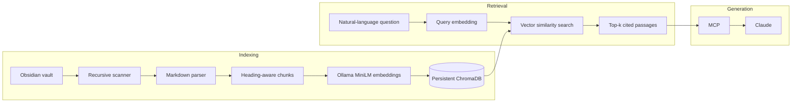

# Obsidian RAG Assistant

[](https://github.com/Amanaakash/Obsidian-RAG-with-Claude-mcp/actions/workflows/ci.yml)
[](https://www.python.org/downloads/)
[](LICENSE)

A local-first retrieval system that semantically searches an Obsidian Markdown vault from the command line or through read-only MCP tools for Claude.

## Features

- Recursively scans Markdown notes while ignoring `.obsidian`, `.git`, `.trash`, and hidden folders.
- Parses headings, YAML front matter, tags, and Obsidian wiki-links.
- Uses heading-aware structural chunking with an 800-character body limit and paragraph boundaries.
- Generates local 384-dimensional embeddings with Ollama and `all-minilm:22m`.
- Stores text, vectors, and source metadata in persistent local ChromaDB.
- Performs dense semantic vector search with file and heading citations.
- Incrementally synchronizes new, changed, and deleted notes without creating duplicates.
- Exposes read-only `search_notes`, `read_note`, and `vault_status` MCP tools.

Current retrieval is dense semantic search only. BM25, hybrid search, overlap, semantic chunking, and reranking are not implemented yet.

## Architecture



MCP does not perform RAG. It exposes the already-working retrieval functions to Claude, which uses the returned evidence to generate an answer.

## Requirements

- Python 3.11 or newer
- [uv](https://docs.astral.sh/uv/getting-started/installation/)
- [Ollama](https://ollama.com/download)
- The `all-minilm:22m` Ollama model

## Quick start

```shell
git clone https://github.com/Amanaakash/Obsidian-RAG-with-Claude-mcp.git
cd Obsidian-RAG-with-Claude-mcp
uv sync --locked
ollama pull all-minilm:22m
```

Ollama normally starts with its desktop application. If it is not running, start it with `ollama serve`. Do not start a second server if port `11434` is already in use.

Index and search the included sample notes:

```shell
uv run obsidian-rag index --vault sample_vault
uv run obsidian-rag search "What is reciprocal rank fusion?"
```

Every result includes its relative source path, heading hierarchy, vector distance, and retrieved text. Distance is a relative ranking signal, not a confidence percentage.

## Use a real Obsidian vault

Choose a separate database directory for each vault:

```shell
uv run obsidian-rag index --vault "/absolute/path/to/ObsidianVault" --db ".rag_data/my_vault"
uv run obsidian-rag search "How do I evaluate retrieval quality?" --db ".rag_data/my_vault"
```

Re-run `index` after changing the vault. Unchanged notes are skipped, changed notes are replaced, new notes are added, and deleted notes are removed from the index.

Changing the embedding model changes the vector dimensions and semantic space. Use a new database directory or rebuild the existing generated index after switching models.

## Claude through MCP

The MCP server reads configuration exclusively from environment variables:

| Variable | Required | Default | Purpose |
|---|---:|---|---|
| `OBSIDIAN_RAG_VAULT` | Yes | — | Absolute path to the Obsidian vault |
| `OBSIDIAN_RAG_DB` | Yes | — | Absolute path to the persistent Chroma directory |
| `OBSIDIAN_RAG_MODEL` | No | `all-minilm:22m` | Ollama embedding model |
| `OBSIDIAN_RAG_COLLECTION` | No | `obsidian_notes` | Chroma collection name |
| `OBSIDIAN_RAG_OLLAMA_HOST` | No | `http://localhost:11434` | Ollama server address |

### Claude Desktop

Merge an `obsidian-rag` entry into Claude Desktop's MCP configuration. Keep any existing server entries.

```json
{
  "mcpServers": {
    "obsidian-rag": {
      "command": "uv",
      "args": [
        "--directory",
        "/absolute/path/to/Obsidian-RAG-with-Claude-mcp",
        "run",
        "obsidian-rag-mcp"
      ],
      "env": {
        "OBSIDIAN_RAG_VAULT": "/absolute/path/to/ObsidianVault",
        "OBSIDIAN_RAG_DB": "/absolute/path/to/Obsidian-RAG-with-Claude-mcp/.rag_data/my_vault",
        "OBSIDIAN_RAG_MODEL": "all-minilm:22m",
        "OBSIDIAN_RAG_COLLECTION": "obsidian_notes"
      }
    }
  }
}
```

On Windows, Claude Desktop stores this file at `%APPDATA%\Claude\claude_desktop_config.json`. Completely quit and reopen Claude Desktop after changing it.

### Claude Code

Register the same stdio server in user scope:

```shell
claude mcp add --scope user obsidian-rag -e "OBSIDIAN_RAG_VAULT=/absolute/path/to/ObsidianVault" -e "OBSIDIAN_RAG_DB=/absolute/path/to/Obsidian-RAG-with-Claude-mcp/.rag_data/my_vault" -e "OBSIDIAN_RAG_MODEL=all-minilm:22m" -e "OBSIDIAN_RAG_COLLECTION=obsidian_notes" -- uv --directory /absolute/path/to/Obsidian-RAG-with-Claude-mcp run obsidian-rag-mcp
```

Each MCP process starts a non-blocking incremental refresh. A cross-process file lock prevents Claude Desktop and Claude Code from writing to Chroma at the same time.

## Privacy and safety

- Vault scanning, embeddings, and Chroma storage run locally.
- The MCP server is read-only and cannot create, edit, or delete notes.
- `read_note` rejects absolute paths, traversal, hidden directories, non-Markdown files, and symlink escapes.
- Passages returned by `search_notes` or `read_note` are sent to Claude when Claude invokes those tools.
- Do not commit `.env`, `.mcp.json`, real vault notes, or `.rag_data` indexes.
- Review third-party MCP server permissions before granting access to a private vault.

## Limitations

- Dense semantic retrieval only; no BM25, hybrid fusion, or reranker.
- Chunk limits are character-based rather than tokenizer-based.
- No chunk overlap is currently used.
- Heading-aware structural chunking is not LLM-based semantic chunking.
- Tags and links are stored as metadata but do not affect ranking.
- Only Markdown is indexed; PDFs, images, Canvas files, and attachments are ignored.
- Retrieval distance is not a calibrated relevance or correctness probability.

## Development

```shell
uv sync --locked --all-groups
uv run pytest -q
uv build
uv run obsidian-rag --help
```

Automated tests use fake embedders and do not require Ollama, Claude, or a real vault. See [CONTRIBUTING.md](CONTRIBUTING.md) before opening a pull request.

## Security and license

Report security issues privately as described in [SECURITY.md](SECURITY.md). This project is available under the [MIT License](LICENSE).
